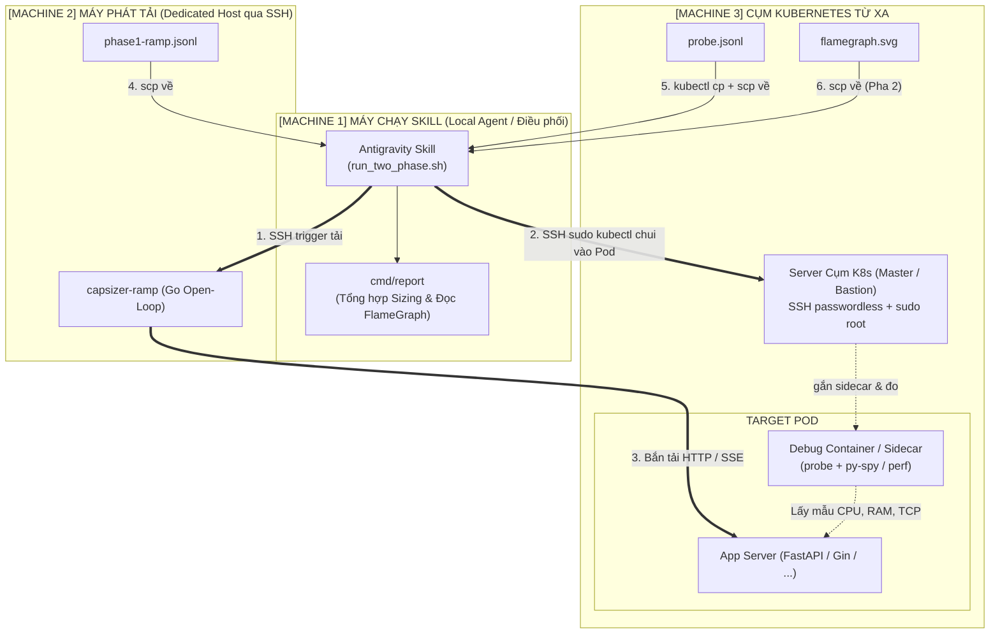

# Capsizer 2-Phase Capacity Sizing & Profiling Workflow (Kiến trúc 3 Máy)

Kỹ năng này tự động hóa toàn bộ quy trình kiểm thử tải và định chuẩn năng lực hệ thống theo chuẩn **2 Pha**, hỗ trợ mô hình triển khai phân tán **3 Máy độc lập**:



---

## 1. Cấu hình phân bổ 3 máy (`.env.remote`)

Khai báo thông số trong file `.env.remote` tại thư mục gốc:

```bash
# [Machine 2] Máy phát tải
LOADGEN_MODE="remote"
REMOTE_HOST="192.168.1.50"
REMOTE_USER="vbox"

# [Machine 3] Server cụm K8s (SSH passwordless + sudo root để chạy kubectl)
K8S_SSH_HOST="192.168.1.100"
K8S_SSH_USER="vbox"
K8S_USE_SUDO="true"
K8S_NAMESPACE="default"
K8S_SELECTOR="app=chatbot"       # Tự động tìm Pod mục tiêu
TARGET_PORT="8000"

# Endpoint dịch vụ
TARGET_URL="http://10.0.0.10:8000/chat"
SCENARIO="chat-sse"
STEPS="2,4,8,16,32"
```

---

## 2. Các bước thực hiện của Agent

### Bước 1: Kiểm tra kết nối 3 máy (Preflight Health Check)
Trước khi chạy bài test dài, Agent chạy lệnh `--check`:
```bash
./.agents/skills/capsizer-two-phase-profiling/scripts/run_two_phase.sh --check
```
Script sẽ kiểm tra:
1. Máy chạy Skill: Có sẵn Go và các công cụ cần thiết.
2. Máy phát tải: SSH thành công và thông mạng tới `TARGET_URL`.
3. Server cụm K8s: SSH passwordless thành công, quyền `sudo root` sẵn sàng, `kubectl` kết nối tốt tới cụm, và Pod mục tiêu đang `Running`.

### Bước 2: Kích hoạt quy trình 2 Pha tự động
```bash
./.agents/skills/capsizer-two-phase-profiling/scripts/run_two_phase.sh
```

**Diễn biến tự động:**
1. **Pha 1 (Capacity Sizing sạch):**
   - Script SSH vào Server cụm K8s, dùng `sudo kubectl` gắn Ephemeral Debug Container (`profiling-sidecar`) và khởi động daemon `probe` trong Pod.
   - Script SSH vào Máy phát tải, kích hoạt `capsizer-ramp` bắn các bậc `2, 4, 8, 16, 32 req/s`.
   - Thu thập `probe.jsonl` từ Pod (qua `kubectl cp` + `scp`) và `ramp.jsonl` từ máy phát tải.
   - Chạy `cmd/report` để tính: CPU cost $C$ (ms/req), RAM baseline/peak, và tự động trích xuất điểm gãy **Knee Point** (ví dụ: `16 req/s`).
2. **Pha 2 (Root-Cause Profiling - chỉ chạy khi gặp điểm gãy):**
   - Kích hoạt máy phát tải giữ đều mức tải tại đúng điểm gãy (`16 req/s`) trong 45s ở background.
   - SSH vào Server K8s, kích hoạt `py-spy` hoặc `perf` lấy mẫu stack trace trong 30s.
   - Xuất file biểu đồ `flamegraph_knee_16rps.svg` và kéo về máy chạy Skill.

### Bước 3: Đọc kết quả và phản hồi cho User
- **Định chuẩn năng lực Pod**: Khuyến nghị số worker tối ưu và mức RAM requests/limits (kèm 30% buffer an toàn).
- **Chẩn đoán điểm gãy**: Nêu rõ nguyên nhân gãy (CFS Throttling, TCP Accept Queue tràn, hay Event Loop bị block).
- **FlameGraph SVG**: Dẫn link file `.svg` để người dùng mở trực tiếp trên trình duyệt soi chi tiết hàm/dòng code gây nghẽn.
