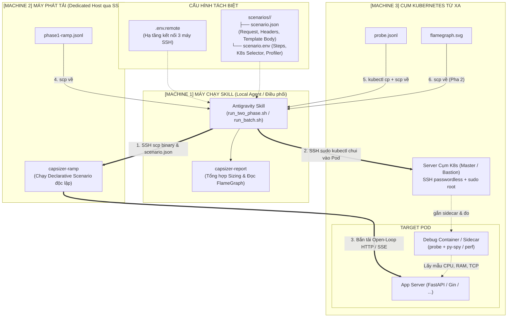

# Capsizer 2-Phase Capacity Sizing & Profiling Workflow (Kiến trúc 3 Máy & Declarative Scenarios)

Kỹ năng này tự động hóa toàn bộ quy trình kiểm thử tải và định chuẩn năng lực hệ thống theo chuẩn **2 Pha**, hỗ trợ triển khai phân tán **3 Máy độc lập** và kiến trúc **Kịch bản khai báo Declarative (tương tự k6)**:



---

## 1. Phân tách Cấu hình Chuẩn Kiến trúc

### A. Cấu hình Hạ tầng cố định (`.env.remote`)
Chỉ chứa thông tin kết nối giữa 3 máy, dùng chung cho mọi kịch bản:
```bash
# [Machine 2] Máy phát tải
LOADGEN_MODE="remote"
REMOTE_HOST="192.168.1.50"
REMOTE_USER="vbox"

# [Machine 3] Server Cụm K8s (SSH passwordless + sudo root để chạy kubectl)
K8S_SSH_HOST="192.168.1.100"
K8S_SSH_USER="vbox"
K8S_USE_SUDO="true"
K8S_NAMESPACE="default"
```

### B. Cấu hình Kịch bản độc lập (`scenarios/<tên_dịch_vụ>/`)
Mỗi kịch bản được tổ chức gọn gàng trong thư mục riêng:
- `scenario.json`: **[Khai báo Request tương tự k6]** Định nghĩa URL, HTTP method, headers, dynamic template body (`{{.Query}}`, `{{.Token}}`, `{{.UUID}}`), logic SSE.
- `scenario.env`: **[Thông số thực thi & K8s]** Dải bậc tải (`STEPS`), selector Pod mục tiêu (`K8S_SELECTOR`), loại profiler (`PROFILE_TYPE=pyspy|perf`).
- Tệp dữ liệu đi kèm (`queries.txt`, `users.csv`, `payload.json`) đặt ngay trong thư mục với đường dẫn tương đối.

*Ví dụ `scenarios/chatbot/`:*
- `scenario.json`:
  ```json
  {
    "name": "chat-sse",
    "type": "sse",
    "url": "http://10.0.0.10:8000/chat",
    "method": "POST",
    "headers": {
      "Content-Type": "application/json",
      "Authorization": "Bearer {{.Token}}"
    },
    "body": "{\"prompt\": \"{{.Query}}\", \"stream\": true}",
    "queries_file": "queries.txt",
    "users_file": "users.csv",
    "sse": { "end_marker": "[DONE]" }
  }
  ```
- `scenario.env`:
  ```bash
  K8S_SELECTOR="app=chatbot"
  PROFILE_TYPE="pyspy"               # Python FastAPI dùng py-spy
  STEPS="2,4,8,16,32"
  STEP_SECONDS="30"
  BASELINE_WAIT="60"
  COOLDOWN="15"
  ```

---

## 2. Quy trình Thực thi của Agent

### Trường hợp 1: Chạy một kịch bản đơn lẻ
Agent kích hoạt kịch bản theo tên thư mục:
```bash
./.agents/skills/capsizer-two-phase-profiling/scripts/run_two_phase.sh --scenario chatbot
```
*(Script sẽ tự động tìm nạp `scenarios/chatbot/scenario.env` + `scenario.json`, tự động đồng bộ file kịch bản và dữ liệu lên máy phát tải từ xa qua SSH).*

### Trường hợp 2: Kiểm tra kết nối trước khi chạy (Preflight Check)
```bash
./.agents/skills/capsizer-two-phase-profiling/scripts/run_two_phase.sh --scenario chatbot --check
```

### Trường hợp 3: Chạy TỰ ĐỘNG HÀNG LOẠT nhiều kịch bản (Batch Runner)
Khi người dùng yêu cầu: *"Hãy chạy kiểm thử tải lần lượt cả chatbot, sample-post và sample-get"*:
```bash
./.agents/skills/capsizer-two-phase-profiling/scripts/run_batch.sh chatbot sample-post sample-get
```
Hoặc quét và chạy toàn bộ kịch bản có trong thư mục `scenarios/`:
```bash
./.agents/skills/capsizer-two-phase-profiling/scripts/run_batch.sh
```
Sau khi hoàn thành tất cả các kịch bản, Agent sẽ đọc file tổng hợp `batch_summary.txt` để đưa ra bảng so sánh hiệu năng và năng lực tổng thể của tất cả các service cho người dùng.
