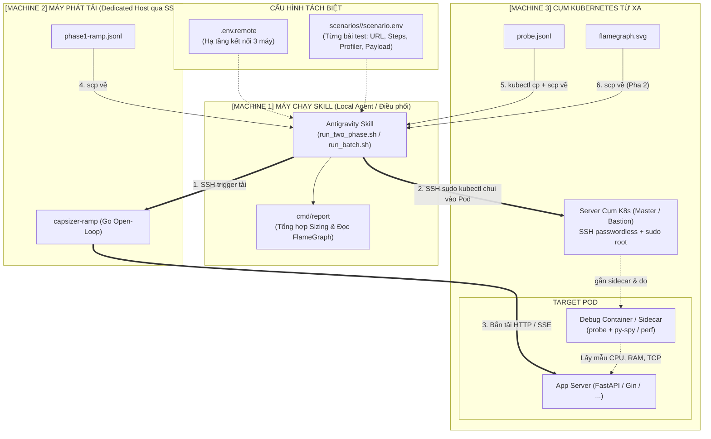

# Capsizer 2-Phase Capacity Sizing & Profiling Workflow (Kiến trúc 3 Máy & Đa Kịch Bản)

Kỹ năng này tự động hóa toàn bộ quy trình kiểm thử tải và định chuẩn năng lực hệ thống theo chuẩn **2 Pha**, hỗ trợ triển khai phân tán **3 Máy độc lập** và kiến trúc **Đa kịch bản (Multi-Scenario)**:



---

## 1. Phân tách Cấu hình Chuẩn Kiến trúc

### A. Cấu hình Hạ tầng cố định (`.env.remote`)
Chỉ chứa thông tin kết nối giữa 3 máy, dùng chung cho mọi kịch bản:
```bash
# [Machine 2] Máy phát tải
LOADGEN_MODE="remote"
REMOTE_HOST="192.168.1.50"
REMOTE_USER="vbox"

# [Machine 3] Server Cụm K8s (SSH passwordless + sudo root để chạy kubectl)
K8S_SSH_HOST="192.168.1.100"
K8S_SSH_USER="vbox"
K8S_USE_SUDO="true"
K8S_NAMESPACE="default"
```

### B. Cấu hình Kịch bản độc lập (`scenarios/<tên_dịch_vụ>/scenario.env`)
Mỗi service hoặc API có một thư mục riêng biệt chứa:
- `scenario.env`: Khai báo endpoint, dải RPS, selector pod, loại profiler (`pyspy` hoặc `perf`).
- Tệp dữ liệu đi kèm (`queries.txt`, `users.csv`, `payload.json`) đặt ngay trong cùng thư mục với đường dẫn tương đối.

*Ví dụ `scenarios/chatbot/scenario.env`:*
```bash
SCENARIO="chat-sse"
TARGET_URL="http://10.0.0.10:8000/chat"
TARGET_PORT="8000"
K8S_SELECTOR="app=chatbot"
PROFILE_TYPE="pyspy"               # Python app dùng py-spy
STEPS="2,4,8,16,32"
QUERIES_FILE="queries.txt"
USERS_FILE="users.csv"
```

*Ví dụ `scenarios/sample-post/scenario.env`:*
```bash
SCENARIO="sample-post"
TARGET_URL="https://jsonplaceholder.typicode.com/posts"
TARGET_PORT="443"
PROFILE_TYPE="perf"                # Golang/Node/Java app dùng perf
STEPS="5,10,20,50"
METHOD="POST"
BODY_FILE="payload.json"
```

---

## 2. Quy trình Thực thi của Agent

### Trường hợp 1: Chạy một kịch bản đơn lẻ
Agent kích hoạt kịch bản theo tên thư mục:
```bash
./.agents/skills/capsizer-two-phase-profiling/scripts/run_two_phase.sh --scenario chatbot
```
*(Script sẽ tự động tìm và nạp `scenarios/chatbot/scenario.env`, tự động đồng bộ `queries.txt` và `users.csv` lên máy phát tải từ xa).*

### Trường hợp 2: Kiểm tra kết nối trước khi chạy (Preflight Check)
```bash
./.agents/skills/capsizer-two-phase-profiling/scripts/run_two_phase.sh --scenario chatbot --check
```

### Trường hợp 3: Chạy TỰ ĐỘNG HÀNG LOẠT nhiều kịch bản (Batch Runner)
Khi người dùng yêu cầu: *"Hãy chạy kiểm thử tải lần lượt cả chatbot và sample-post"*:
```bash
./.agents/skills/capsizer-two-phase-profiling/scripts/run_batch.sh chatbot sample-post
```
Hoặc chạy toàn bộ kịch bản có trong thư mục `scenarios/`:
```bash
./.agents/skills/capsizer-two-phase-profiling/scripts/run_batch.sh
```
Sau khi hoàn thành tất cả các kịch bản, Agent sẽ đọc file tổng hợp `batch_summary.txt` để đưa ra bảng so sánh hiệu năng và năng lực tổng thể của tất cả các service cho người dùng.
