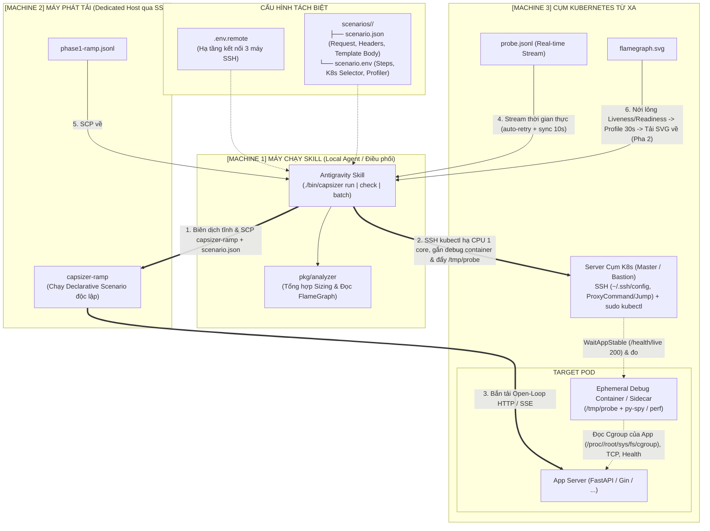

# Capsizer 2-Phase Capacity Sizing & Profiling Workflow (Golang CLI — Kiến trúc 3 Máy)

Kỹ năng này tự động hóa toàn bộ quy trình kiểm thử tải và định chuẩn năng lực hệ thống theo chuẩn **2 Pha** thông qua bộ điều phối thuần **Golang CLI (`./bin/capsizer`)**, hỗ trợ triển khai phân tán **3 Máy độc lập** và kiến trúc **Kịch bản khai báo Declarative (tương tự k6)**:



---

## 1. Phân tách Cấu hình Chuẩn Kiến trúc

### A. Cấu hình Hạ tầng cố định (`.env.remote`)
Chỉ chứa thông tin kết nối giữa 3 máy, dùng chung cho mọi kịch bản (hỗ trợ đầy đủ alias, `ProxyJump` và `ProxyCommand` trong `~/.ssh/config` khi để trống user/port/key):
```bash
# [Machine 2] Máy phát tải
LOADGEN_MODE="remote"
REMOTE_HOST="192.168.1.50"
REMOTE_USER="vbox"

# [Machine 3] Server Cụm K8s (SSH passwordless + sudo root để chạy kubectl)
K8S_SSH_HOST="192.168.1.100"
K8S_SSH_USER="vbox"
K8S_USE_SUDO="true"
K8S_NAMESPACE="default"
```

### B. Cấu hình Kịch bản độc lập (`scenarios/<tên_dịch_vụ>/`)
Mỗi kịch bản được tổ chức gọn gàng trong thư mục riêng:
- `scenario.json`: **[Khai báo Request tương tự k6]** Định nghĩa URL, HTTP method, headers, dynamic template body, datasets (Generic Data Feeders), logic SSE.
- `scenario.env`: **[Thông số thực thi & K8s]**
  - `STEPS`, `STEP_SECONDS`, `BASELINE_WAIT`, `COOLDOWN`: Dải bậc tải và thời gian.
  - `K8S_SELECTOR`: Label selector tìm Pod mục tiêu (vd: `app=chatbot`).
  - `SET_POD_CPU` *(Khuyến nghị)*: Tự động đưa CPU Pod về 1 core (`"1"` hoặc `"1000m"`) để tìm điểm gãy chính xác và đo chuẩn $C$ của 1 worker. Tự động nhận diện Deployment/StatefulSet cha qua `ownerReferences` và tự động hoàn nguyên về CPU ban đầu sau khi kết thúc.
  - `RESTORE_POD_CPU` *(Tùy chọn)*: Mặc định `true` (tự hoàn nguyên CPU cũ).
  - `PROFILE_TYPE`: Hỗ trợ đơn lẻ (`pyspy`, `perf`) hoặc **đa profiler chạy tuần tự** (`pyspy,perf` hoặc `all`), xuất riêng từng file `flamegraph_knee_<RPS>rps_<prof>.svg`.
  - `TARGET_PORT` *(Tùy chọn)*: Mặc định tự động bóc tách từ `url` trong `scenario.json`.

---

## 2. Cơ chế Tự động Bảo vệ & Nới lỏng Liveness/Readiness Probes trong `./bin/capsizer`

Bộ điều phối Golang (`pkg/orchestrator/runner.go` & `pkg/orchestrator/k8s.go`) xử lý tự động hoàn toàn vòng đời Pod qua 2 Pha:

1. **Trước Pha 1 (Chuẩn bị, Health Gate & Business Warm-up)**:
   - Hạ CPU Workload về `SET_POD_CPU` (nếu cấu hình), gắn Ephemeral Debug Container (`capsizer-debugger`) với quyền root (`runAsNonRoot: false`), biên dịch tĩnh và đồng bộ `/tmp/probe` mới nhất (đọc đúng cgroup của container ứng dụng qua `/proc/<pid>/root/sys/fs/cgroup`).
   - Chạy **Health Gate (`waitAppStable`)**: Poll `/health/live` qua `probe -once` cho đến khi đạt `3` lần liên tiếp `health_code: 200` (tối đa `90s`).
   - Chạy **Business Warm-up (`warmupApplication`)**: Bắn request mồi thật từ kịch bản (`0.5 req/s`) để ép ứng dụng hoàn tất mọi tác vụ khởi tạo lười (như giải nén model `langid`/`bz2.decompress`, nạp từ điển BM25, mở DB pool) cho đến khi `TTFT` ổn định trước khi bắt đầu đo Pha 1.
2. **Trong Pha 1 (Giữ nguyên Probes gốc & Stream thời gian thực)**:
   - Giữ nguyên `livenessProbe` / `readinessProbe` thực tế của Production để phát hiện trung thực bậc tải làm ứng dụng bị nghẽn hoặc bị K8s Liveness kill.
   - Luồng `probe.jsonl` được stream thời gian thực về máy chạy Skill (kèm vòng lặp auto-retry `2s` và ticker đồng bộ dự phòng + kiểm tra trạng thái container mỗi `10s`).
   - Bộ phân tích `pkg/analyzer` đánh giá 2 chiều: tự động lọc nhiễu cold-start ở bậc đầu (nếu có), kết hợp tiêu chí nhảy vọt độ trễ (`ttftP50 >= 4x` nền) và ngưỡng CFS CPU throttling thực tế trên 1 core để xác định chính xác `KneeRPS` và `ProfileRPS` (vùng ứng dụng còn sống và đang chịu áp lực thật).
3. **Trước Pha 2 (Tự động Nới lỏng `livenessProbe` & `readinessProbe` + Warm-up lại Pod mới)**:
   - Khi chuyển sang Pha 2, `./bin/capsizer` tự động gọi `RelaxWorkloadProbes`:
     - Sao lưu nguyên vẹn JSON gốc của `livenessProbe` và `readinessProbe`.
     - Patch tạm thời `failureThreshold: 60` và `timeoutSeconds: 10` (nếu `< 10s`) cho cả `livenessProbe` và `readinessProbe`.
     - Chờ Pod mới rollout `Ready` $\rightarrow$ gắn lại `capsizer-debugger` & `/tmp/probe` $\rightarrow$ chờ `waitAppStable` $\rightarrow$ **chạy lại `warmupApplication` (bắn request kịch bản thật)** để Pod mới ấm hoàn toàn trước khi bật `py-spy` (30s) và `perf` (30s) tại `ProfileRPS`.
4. **Khi kết thúc (hoặc nhấn `Ctrl+C`)**:
   - Cơ chế `defer` gọi `RestoreWorkloadState` gộp cả `resources` (CPU) lẫn `livenessProbe` và `readinessProbe` gốc vào **1 lệnh JSON patch nguyên tử duy nhất**, khôi phục hoàn toàn cấu hình ban đầu của Workload chỉ trong 1 lần rollout.

---

## 3. Quy trình Thực thi của Agent (100% Golang CLI `./bin/capsizer`)

Trước khi chạy (hoặc khi mã nguồn Go vừa cập nhật), đảm bảo binary `./bin/capsizer` đã được biên dịch mới nhất:
```bash
go build -o bin/capsizer ./cmd/capsizer
```

### Trường hợp 1: Kiểm tra kết nối 3 máy trước khi chạy (Preflight Check)
```bash
./bin/capsizer check --scenario chatbot
```

### Trường hợp 2: Chạy một kịch bản đơn lẻ (Single Scenario)
```bash
./bin/capsizer run --scenario chatbot
```
*(Hệ thống tự động nạp `.env.remote` + `scenarios/chatbot/scenario.env` + `scenario.json`, đồng bộ binary lên máy phát tải và cụm K8s, thực thi trọn vẹn Pha 1 & Pha 2).*

### Trường hợp 3: Chạy TỰ ĐỘNG HÀNG LOẠT nhiều kịch bản (Batch Runner)
```bash
# Chạy danh sách kịch bản chỉ định:
./bin/capsizer batch chatbot sample-post sample-get

# Hoặc quét và chạy toàn bộ kịch bản trong thư mục scenarios/:
./bin/capsizer batch
```

### Trường hợp 4: Đọc và Phân tích Kết quả sau khi chạy
Sau khi `./bin/capsizer` hoàn tất, Agent đọc trực tiếp các tạo phẩm trong thư mục kết quả (`benchmark-results/<run_id>/`):
1. `phase1-report.txt`: Bảng phân tích theo từng bậc RPS (`p50`, `p95`, `p99`, `CPU cores`, `throttle%`, `ramMB`, `LISTEN queue`, `/health/live`), chẩn đoán cơ chế gây nghẽn, điểm gãy (`Knee Point`) và công thức tính số bản sao (Replicas / Workers) cần thiết.
2. `flamegraph_knee_<RPS>rps_pyspy.svg` & `flamegraph_knee_<RPS>rps_perf.svg`: Biểu đồ FlameGraph tại bậc tải gãy để chỉ ra chính xác hàm Python / C-extension / Kernel gây nghẽn CPU.
