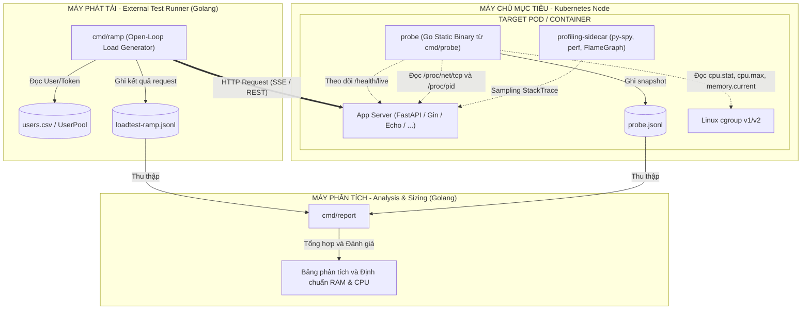
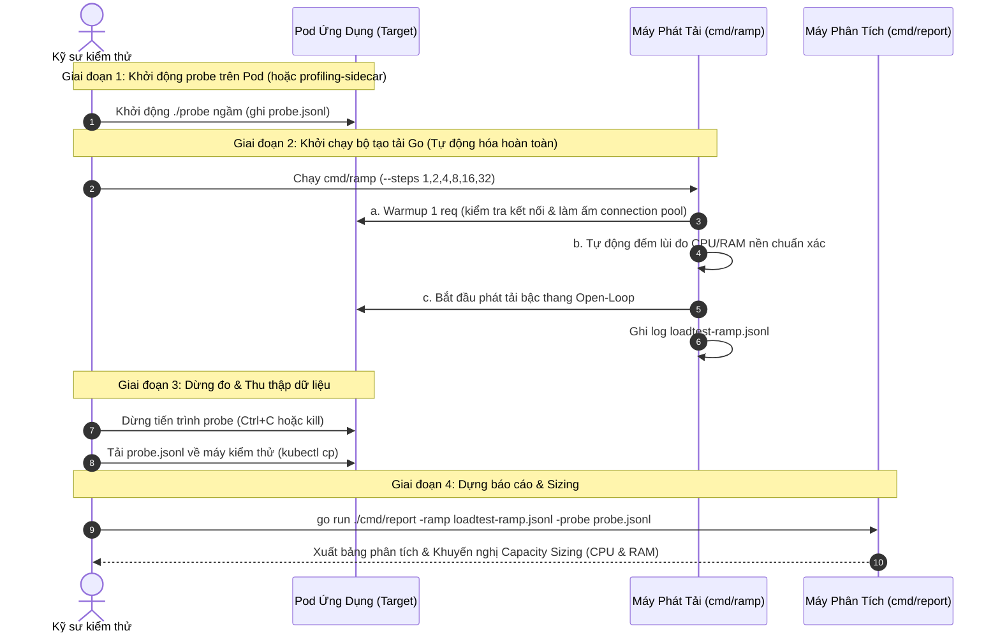
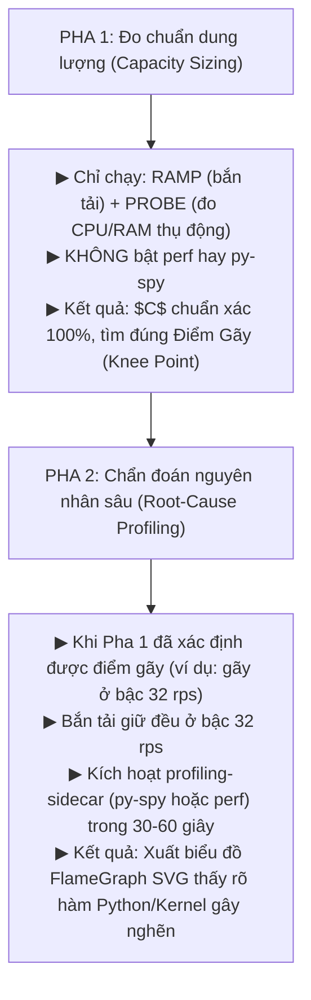

# Capsizer: Bộ công cụ kiểm thử tải & Định chuẩn hiệu năng (Capacity Sizing)

Bộ công cụ chuyên dụng viết bằng **Golang** dùng để đo lường, kiểm thử tải và định chuẩn hiệu năng (benchmarking & capacity sizing) cho các dịch vụ Backend / AI Chatbot (FastAPI, Uvicorn, Gin, Echo, SSE Streaming,...).

Bộ công cụ giúp trả lời các câu hỏi cốt lõi về mặt kỹ thuật:
1. **Thông lượng tối đa (Max RPS)** mà một Pod / Instance có thể chịu được trước khi gãy là bao nhiêu?
2. **Chi phí CPU cho mỗi request ($C$)** là bao nhiêu mili-giây?
3. **Cấu hình bao nhiêu worker và cấp bao nhiêu CPU core (cgroup quota)** là tối ưu?
4. **Điểm gãy (knee point / saturation point)** xảy ra do đâu: nghẽn CPU (CFS throttling), nghẽn Event Loop hay ứ đọng hàng đợi TCP (accept queue)?

---

## Mục lục
- [1. Kiến trúc & Mô hình chạy (Architecture & Execution Model)](#1-kiến-trúc--mô-hình-chạy-architecture--execution-model)
  - [Mô hình triển khai phân tán](#mô-hình-triển-khai-phân-tán)
  - [Cơ chế phát tải Open-Loop](#cơ-chế-phát-tải-open-loop)
  - [Mô hình định chuẩn năng lực (Capacity Sizing Model)](#mô-hình-định-chuẩn-năng-lực-capacity-sizing-model)
- [2. Các thành phần trong bộ công cụ](#2-các-thành-phần-trong-bộ-công-cụ)
- [3. Yêu cầu môi trường & Cài đặt](#3-yêu-cầu-môi-trường--cài-đặt)
- [4. Hướng dẫn chạy từng bước (Workflow chuẩn)](#4-hướng-dẫn-chạy-từng-bước-workflow-chuẩn)
- [5. Hướng dẫn chi tiết từng công cụ](#5-hướng-dẫn-chi-tiết-từng-công-cụ)
  - [cmd/probe - Thu thập chỉ số hệ thống RAM/CPU (Static Binary)](#cmdprobe---thu-thập-chỉ-số-hệ-thống-ramcpu-static-binary)
  - [profiling-sidecar - Container phân tích sâu & FlameGraph](#profiling-sidecar---container-phân-tích-sâu--flamegraph)
  - [cmd/ramp - Bộ phát tải Open-Loop Go (Đa kịch bản)](#cmdramp---bộ-phát-tải-open-loop-go-đa-kịch-bản-chat-sse-rest-api)
    - [Tổ chức kịch bản theo Service trong pkg/scenarios](#cách-tổ-chức-thư-mục--thêm-kịch-bản-scenario-mới-cho-từng-service)
    - [Docker Base Image & Kế thừa kịch bản mới](#hướng-dẫn-docker-build-base-image--kế-thừa-khi-thêm-kịch-bản-mới)
  - [cmd/report - Phân tích dữ liệu & Định chuẩn RAM/CPU](#cmdreport---phân-tích-dữ-liệu--định-chuẩn-ramcpu)
- [6. Kịch bản thực tế mẫu (End-to-End Walkthrough)](#6-kịch-bản-thực-tế-mẫu-end-to-end-walkthrough)
- [7. Các lưu ý kỹ thuật quan trọng (Best Practices)](#7-các-lưu-ý-kỹ-thuật-quan-trọng-best-practices)
  - [Quy trình chuẩn 2 Pha: Đo Capacity Sizing sạch vs Chẩn đoán sâu (FlameGraph)](#4-quy-trình-chuẩn-2-pha-đo-capacity-sizing-sạch-vs-chẩn-đoán-sâu-flamegraph--profiling)
- [8. Capsizer khác gì các bài kiểm thử hiệu năng truyền thống?](#8-capsizer-khác-gì-các-bài-kiểm-thử-hiệu-năng-truyền-thống)

---

## 1. Kiến trúc & Mô hình chạy (Architecture & Execution Model)

### Mô hình triển khai phân tán

Để kết quả đo đạc phản ánh chính xác hiệu năng của dịch vụ mà không bị sai lệch bởi việc tranh chấp tài nguyên, các công cụ được phân bổ theo mô hình sau:



- **Máy phát tải (Generator Host)**: Chạy bộ phát tải Go ([`cmd/ramp`](file:///home/vbox/projects/capsizer/cmd/ramp)) từ bên ngoài Pod (máy trạm kỹ sư, VM kiểm thử hoặc Pod loadtest độc lập). **Tuyệt đối không chạy bộ tạo tải bên trong cùng container của ứng dụng** để tránh việc tiến trình phát tải tranh chấp CPU/RAM với ứng dụng mục tiêu.
- **Pod / Container mục tiêu (Target Pod)**: Chạy daemon [`cmd/probe`](file:///home/vbox/projects/capsizer/cmd/probe) (được biên dịch thành file binary tĩnh `probe` siêu nhẹ ~6MB) hoặc gắn [`profiling-sidecar`](file:///home/vbox/projects/capsizer/profiling-sidecar) trực tiếp vào Pod của ứng dụng. Nhờ nằm chung Linux namespace và cgroup, `probe` đọc trực tiếp các file ảo `/proc/net/tcp`, `/proc/<pid>/*` và `/sys/fs/cgroup` mà không cần bất kỳ runtime (Python/Node) hay công cụ bổ trợ nào.
- **Tổng hợp & Báo cáo (Analysis)**: Sau khi đợt kiểm thử kết thúc, cả 2 file `loadtest-ramp.jsonl` và `probe.jsonl` được đưa về để [`cmd/report`](file:///home/vbox/projects/capsizer/cmd/report) đối chiếu theo dòng thời gian, tính toán $C$ (ms CPU / req) và lập bảng định chuẩn cả CPU lẫn RAM.

---

### Cơ chế phát tải Open-Loop

Khác với các công cụ kiểm thử tải truyền thống theo cơ chế **Closed-Loop** (chỉ gửi request mới khi request trước đó đã nhận xong hoặc bị giới hạn bởi số lượng VUs/concurrency cố định), bộ phát tải của Capsizer áp dụng mô hình **Open-Loop**:

```
Closed-Loop (Mô hình truyền thống):
  Client ---> [Gửi Req 1] --------> Server (chậm)
                                       |
  Client <--- [Nhận Resp 1] <----------+ (Sau 5s)
  Client ---> [Gửi Req 2] (Bị chậm theo server => Che giấu hiện tượng sập hàng đợi!)

Open-Loop (Mô hình của Capsizer):
  t = 0.0s:  Client ---> [Gửi Req 1] -------------------> Server
  t = 0.2s:  Client ---> [Gửi Req 2] -------------------> Server
  t = 0.4s:  Client ---> [Gửi Req 3] -------------------> Server
             (Bất kể Server đã xử lý xong hay chưa => Bộc lộ rõ hiện tượng nghẽn hàng đợi!)
```

**Ưu điểm của Open-Loop:**
- Phản ánh đúng hành vi người dùng thực tế: Người dùng không ngừng gửi yêu cầu khi hệ thống chậm lại.
- Làm bộc lộ rõ tình trạng ứ đọng trong hàng đợi hệ điều hành (TCP Accept Queue) và độ trễ nhận mảnh dữ liệu đầu tiên (TTFT - Time To First Token).
- Dễ dàng phát hiện **điểm gãy (knee point)** khi throughput hoàn thành thực tế (`achieved`) sụt giảm so với tốc độ yêu cầu (`offered`).

---

### Mô hình định chuẩn năng lực (Capacity Sizing Model)

Hệ thống tính toán năng lực xử lý dựa trên định luật công suất CPU:

1. **Thời gian CPU thuần cho mỗi request ($C$)**:
   $$\text{Baseline CPU} = \frac{\Delta \text{CPU Usage (khi không tải)}}{\text{Thời gian quan sát (giây)}}$$
   $$C = \frac{\Delta \text{CPU Usage (trong bước tải)} - (\text{Baseline CPU} \times \text{Thời gian bước})}{\text{Số request thành công}} \quad (\text{mili-giây CPU / request})$$

2. **Trần lý thuyết của 1 Worker (1 core CPU)**:
   $$\text{RPS}_{\text{max, 1 worker}} = \frac{1000}{C} \quad (\text{req/s})$$

3. **Trần lý thuyết của Pod được cấp $N$ core CPU quota**:
   $$\text{RPS}_{\text{max, Pod}} = \frac{N \times 1000}{C} \quad (\text{req/s})$$

4. **Số lượng Worker tối ưu**:
   $$\text{Số Worker} \approx \text{CPU Quota Cores} \quad (\text{ví dụ: quota 2.0 cores} \rightarrow 2 \text{ workers})$$

5. **Nhận diện điểm gãy (Knee Detection Criteria)**:
   Một bước kiểm thử bị coi là vượt ngưỡng chịu tải (`KNEE`) nếu vi phạm bất kỳ tiêu chí nào sau:
   - `achieved < 0.90 * offered`: Throughput thực tế đạt dưới 90% mức yêu cầu (ứ đọng hàng đợi).
   - `acceptQ > 0`: Hàng đợi TCP socket lắng nghe có kết nối chờ xử lý mà worker chưa kịp `accept()`.
   - `health_ms (p99) > 1000ms`: Event loop của ứng dụng bị chặn (blocking) khiến endpoint health check phản hồi trên 1 giây.
   - `throttled > 5%`: Tỷ lệ chu kỳ CFS bị bóp nghẽn CPU vượt quá 5%.
   - `abandoned`: Có request bị hủy do vượt quá thời gian dọn dẹp cuối bước (`--settle`).

---

## 2. Các thành phần trong bộ công cụ

Toàn bộ hệ thống được viết bằng **Golang** (chỉ sử dụng Go standard library, không phụ thuộc thư viện ngoài), thiết kế tách biệt giữa **Runner Engine** (điều phối tải), **System Probe** (thu thập chỉ số OS/cgroup) và **Report Analyzer** (phân tích định chuẩn):

| Tệp tin / Thư mục | Chức năng chính | Ngôn ngữ / Phụ thuộc | Vị trí thực thi |
| :--- | :--- | :--- | :--- |
| [`cmd/probe/`](file:///home/vbox/projects/capsizer/cmd/probe) & [`pkg/probe/`](file:///home/vbox/projects/capsizer/pkg/probe) | Daemon thu thập chỉ số hệ thống (cgroup quota, CFS throttling, memory/RAM, TCP queue, socket states, worker threads/fds, health latency). Biên dịch thành static binary chạy trên mọi container | Go 1.20+ (Chỉ dùng thư viện chuẩn) | Bên trong Pod mục tiêu |
| [`profiling-sidecar/`](file:///home/vbox/projects/capsizer/profiling-sidecar) | Container chuyên dụng tích hợp `probe`, `py-spy`, `perf`, và Brendan Gregg `FlameGraph` để phân tích sâu & xuất biểu đồ SVG | Docker / Linux | K8s Sidecar / Debug Container |
| [`cmd/report/`](file:///home/vbox/projects/capsizer/cmd/report) & [`pkg/analyzer/`](file:///home/vbox/projects/capsizer/pkg/analyzer) | Phân tích và tương quan log `ramp.jsonl` và `probe.jsonl`, tính toán chỉ số $C$, định chuẩn RAM/CPU và lập bảng capacity planning | Go 1.20+ (Chỉ dùng thư viện chuẩn) | Máy phân tích |
| [`cmd/ramp/`](file:///home/vbox/projects/capsizer/cmd/ramp) & [`pkg/engine/`](file:///home/vbox/projects/capsizer/pkg/engine) | **Bộ phát tải Open-Loop Engine chạy bằng Go ⚡⚡⚡**: Goroutines dispatcher, Connection Pooling lớn, scheduler độ chính xác cao | Go 1.20+ | Máy phát tải bên ngoài |
| [`pkg/scenarios/`](file:///home/vbox/projects/capsizer/pkg/scenarios) | Kho kịch bản Go: `chatbot/chat_sse.go`, `sample/get_posts.go`, `sample/create_post.go`, `registry.go`, `utils.go` | Go 1.20+ | Module kịch bản Go |

---

## 3. Yêu cầu môi trường & Cài đặt

### Yêu cầu
- **Go 1.20 trở lên** trên máy phát tải / máy phân tích.
- Hệ điều hành Linux trên Pod mục tiêu (hỗ trợ cgroup v1 hoặc v2, đọc `/proc`).

### Cài đặt & Sử dụng

1. **Trên máy phát tải (Bộ phát tải Go `cmd/ramp`):**
   *Không cần cài thêm thư viện bên ngoài (chỉ dùng Go standard library):*
   ```bash
   # Cách 1: Chạy trực tiếp qua go run:
   go run ./cmd/ramp --help

   # Cách 2: Biên dịch thành binary độc lập:
   go build -o capsizer-ramp ./cmd/ramp
   ./capsizer-ramp --help
   ```

2. **Trên Pod / Container mục tiêu (chạy daemon `probe` hoặc dùng `profiling-sidecar`):**
   Biên dịch tĩnh `cmd/probe` thành binary độc lập trên máy dev/CI rồi copy vào Pod:
   ```bash
   # Biên dịch file thực thi tĩnh (Linux x86_64)
   CGO_ENABLED=0 GOOS=linux GOARCH=amd64 go build -ldflags="-s -w" -o probe ./cmd/probe

   # Copy vào pod và chạy trực tiếp
   kubectl cp probe ${NAMESPACE}/${POD_NAME}:/tmp/probe
   kubectl exec -it ${NAMESPACE}/${POD_NAME} -- /tmp/probe --port 8000 --out /tmp/probe.jsonl
   ```
   *Hoặc triển khai sẵn `profiling-sidecar` (xem chi tiết trong thư mục [`profiling-sidecar/`](file:///home/vbox/projects/capsizer/profiling-sidecar)).*

3. **Trên máy phân tích (chạy `cmd/report`):**
   ```bash
   # Cách 1: Chạy trực tiếp qua go run:
   go run ./cmd/report -ramp <ramp.jsonl> -probe <probe.jsonl>

   # Cách 2: Biên dịch thành binary:
   go build -o report ./cmd/report
   ./report -ramp <ramp.jsonl> -probe <probe.jsonl>
   ```

---

## 4. Hướng dẫn chạy từng bước (Workflow chuẩn)

Để có kết quả đo đạc chính xác nhất, quy trình chuẩn gồm 4 bước như sau:



---

## 5. Hướng dẫn chi tiết từng công cụ

### cmd/probe - Thu thập chỉ số hệ thống RAM/CPU (Static Binary)

[`cmd/probe`](file:///home/vbox/projects/capsizer/cmd/probe) chỉ dùng thư viện chuẩn của Go, biên dịch thành một file binary tĩnh độc lập (static binary ~6MB), chạy được trên mọi container Linux (kể cả container Python FastAPI/Uvicorn, container Golang hay các image tối giản **Distroless**, **Alpine**, **Scratch** không có shell hay runtime).

#### Biên dịch tĩnh `cmd/probe`
Biên dịch ngay trên máy phát tải hoặc trong quy trình CI/CD:
```bash
# Biên dịch cho Linux x86_64 (amd64)
CGO_ENABLED=0 GOOS=linux GOARCH=amd64 go build -ldflags="-s -w" -o probe ./cmd/probe

# Biên dịch cho Linux ARM64 (Apple Silicon k8s / AWS Graviton)
CGO_ENABLED=0 GOOS=linux GOARCH=arm64 go build -ldflags="-s -w" -o probe ./cmd/probe
```

#### Cú pháp dòng lệnh
```bash
# Chạy trực tiếp qua go run
go run ./cmd/probe [OPTIONS]

# Hoặc chạy binary tĩnh đã biên dịch
./probe [OPTIONS]
```

#### Bảng tham số
| Tham số | Giá trị mặc định | Giải thích |
| :--- | :--- | :--- |
| `-out` | `probe.jsonl` | Đường dẫn file JSONL lưu kết quả lấy mẫu |
| `-interval` | `1.0` | Chu kỳ lấy mẫu dữ liệu (tính bằng giây) |
| `-port` | `0` | Cổng dịch vụ của ứng dụng (để lọc TCP socket & đo Accept Queue) |
| `-health-url` | `""` | URL kiểm tra `/health/live` của dịch vụ |
| `-health-timeout` | `2.0` | Thời gian timeout khi kiểm tra health check (giây) |
| `-pid` | `0` | PID của tiến trình worker đơn lẻ |
| `-parent-pid` | `0` | PID của master process (để quét toàn bộ worker con) |
| `-once` | `false` | In 1 snapshot metadata và dữ liệu ra màn hình rồi thoát ngay |

---

### profiling-sidecar - Container phân tích sâu & FlameGraph

Ngoài daemon `probe` siêu nhẹ, dự án tích hợp sẵn container [`profiling-sidecar/`](file:///home/vbox/projects/capsizer/profiling-sidecar) được đóng gói sẵn các công cụ profiling chuyên sâu:
- **`py-spy`**: Profiler Python tốc độ cao, không dừng GIL, trích xuất FlameGraph CPU trực tiếp.
- **`perf`**: Linux kernel profiling (`perf record` + `flamegraph.pl` tần số 99Hz).
- **`analyze-connections`**: Điều tra trạng thái TCP, phát hiện rò rỉ socket `CLOSE-WAIT`, nghẽn `Recv-Q/Send-Q`.

Xem hướng dẫn chi tiết về triển khai Kubernetes (`kubectl debug`, Pod sidecar) tại [`profiling-sidecar/README.md`](file:///home/vbox/projects/capsizer/profiling-sidecar/README.md).

---

### cmd/ramp - Bộ phát tải Open-Loop Go (Đa kịch bản: Chat SSE, REST API)

Bộ phát tải được viết bằng **Go (Golang)**, tận dụng tối đa cơ chế Goroutines nhẹ và HTTP connection pooling lớn để đạt độ chính xác lịch trình phát tải cực cao:
1. `chat-sse` (mặc định): Đo endpoint Chatbot streaming SSE (`POST /chat`), đo TTFT theo thời gian thực.
2. `sample-get`: Kịch bản mẫu gọi REST API GET công khai (mặc định đo Public API JSONPlaceholder `GET /posts/1`).
3. `sample-post`: Kịch bản mẫu gửi JSON payload lên REST API công khai (mặc định đo Public API JSONPlaceholder `POST /posts`).

#### Cú pháp dòng lệnh
```bash
# Cách 1: Chạy trực tiếp qua go run:
go run ./cmd/ramp [OPTIONS]

# Cách 2: Biên dịch thành binary độc lập (Khuyên dùng khi triển khai Pod/VM tải):
go build -o capsizer-ramp ./cmd/ramp
./capsizer-ramp [OPTIONS]

# Cách 3: Chạy qua Docker (Image runner siêu nhẹ ~20MB):
docker build -t capsizer-ramp .
docker run --rm -it -v $(pwd):/data capsizer-ramp [OPTIONS]

# Cách 4: Chạy tiện lợi qua Docker Compose:
# Phát tải với runner:
docker compose run --rm ramp [OPTIONS]

# Phát tải chế độ Dev (tự động nạp kịch bản mới trong pkg/scenarios/):
docker compose run --rm ramp-dev -scenario <tên_kịch_bản> [OPTIONS]

# Xuất bảng phân tích sizing:
docker compose run --rm report -ramp loadtest-ramp.jsonl [-probe probe.jsonl]

# Build base image để mở rộng kịch bản mới:
docker build --target base -t capsizer-ramp:base .
```

#### Bảng tham số
| Tham số | Giá trị mặc định | Giải thích |
| :--- | :--- | :--- |
| `-scenario` | `chat-sse` | Kịch bản kiểm thử: `chat-sse` (mặc định), `sample-get`, `sample-post` hoặc service tùy chỉnh |
| `-method` | `GET` | HTTP method cho kịch bản REST (`GET`, `POST`, `PUT`, `DELETE`,...) |
| `-H`, `-header` | `None` | Thêm HTTP header tùy chọn (ví dụ: `-H 'Authorization: Bearer xxx' -H 'X-Api-Key: 123'`) |
| `-body` | `""` | Chuỗi body gửi kèm cho request REST (chuỗi JSON hoặc chuỗi text thô) |
| `-body-file` | `""` | Đường dẫn file chứa dữ liệu body cho request REST |
| `-url` | `http://127.0.0.1:8000/chat` | URL endpoint nhận request (khi dùng `sample-get`/`sample-post` có thể để trống để dùng Public API mặc định hoặc truyền URL của bạn) |
| `-steps` | `1,2,4,8,16,32` | Danh sách các mức RPS cần đo, phân tách bằng dấu phẩy |
| `-step-seconds` | `60.0` | Thời gian phát tải ở mỗi mức RPS (giây) |
| `-cooldown` | `20.0` | Thời gian nghỉ giải tỏa tải giữa 2 bậc RPS (giây) |
| `-settle` | `60.0` | Thời gian chờ tối đa cho các request dở dang cuối mỗi bậc |
| `-timeout` | `120.0` | Read timeout cho mỗi request (giây) |
| `-max-inflight` | `2000` | Trần kết nối đồng thời tối đa của máy phát tải (bảo vệ máy phát tải) |
| `-users-csv` | `users.csv` | Đường dẫn file CSV chứa danh sách user (cột `token`, `user_token` hoặc fuzzy match) |
| `-user-token` | `loadtest-token` | Token dùng chung khi không sử dụng file CSV (cho kịch bản `chat-sse`) |
| `-jwt` | `""` | JWT token có sẵn gửi trong header `Authorization: Bearer <token>` |
| `-jwt-secret` | `$JWT_SECRET` | Secret ký HS256 JWT nếu chưa có sẵn token (quyền `super_admin`) |
| `-queries` | `""` | File chứa danh sách câu hỏi kiểm thử cho chatbot (bắt buộc cho `chat-sse` nếu không cấu hình `.env`, mỗi dòng một câu) |
| `-env-file` | `.env` | File cấu hình môi trường chứa `CHAT_QUERIES`, `JWT_SECRET`,... |
| `-insecure` | `false` | Bỏ qua kiểm tra chứng chỉ TLS (khi qua Ingress cert tự ký) |
| `-cache-bust` | `false` | Thêm mã ngẫu nhiên vào câu hỏi để tránh cache |
| `-stop-on-knee` | `false` | Tự động ngắt kịch bản khi `achieved < 90% offered` |
| `-baseline-wait` | `90.0` | Thời gian chờ hệ thống nghỉ để đo CPU nền chuẩn xác trước bậc 1 (giây; đặt `0` để bỏ qua) |
| `-skip-warmup` | `false` | Bỏ qua bước kiểm tra kết nối & làm ấm connection pool ban đầu |
| `-out` | `loadtest-ramp.jsonl` | File JSONL xuất kết quả kiểm thử tải |

*(Lưu ý: Bộ cờ của Go hỗ trợ cả cú pháp 1 gạch ngang `-flag` và 2 gạch ngang `--flag`).*

#### Ví dụ chạy thực tế

- **Ví dụ 1: Test API Chatbot streaming SSE (Kịch bản mặc định):**
  ```bash
  export JWT_SECRET="your-jwt-secret-key"
  go run ./cmd/ramp \
    -scenario chat-sse \
    -url "https://api.example.com/chat" \
    -queries queries.txt \
    -users users.csv \
    -steps "2,4,8,12,16" \
    -step-seconds 60 \
    -cooldown 20 \
    -baseline-wait 90 \
    -skip-verify \
    -out loadtest-ramp.jsonl
  ```

- **Ví dụ 2: Test Public API REST GET (Kịch bản mẫu sample-get):**
  ```bash
  # Đo trực tiếp Public API JSONPlaceholder:
  go run ./cmd/ramp \
    -scenario sample-get \
    -steps "2,4,8,16" \
    -step-seconds 10 \
    -baseline-wait 0 \
    -out loadtest-sample-get.jsonl

  # Hoặc truyền URL của riêng bạn:
  go run ./cmd/ramp \
    -scenario sample-get \
    -url "https://api.example.com/posts/1" \
    -steps "10,20,50" \
    -step-seconds 30 \
    -out loadtest-posts.jsonl
  ```

- **Ví dụ 3: Test Public API REST POST gửi kèm JSON (Kịch bản mẫu sample-post):**
  ```bash
  # Đo trực tiếp Public API POST:
  go run ./cmd/ramp \
    -scenario sample-post \
    -steps "2,4,8" \
    -step-seconds 10 \
    -baseline-wait 0 \
    -out loadtest-sample-post.jsonl

  # Hoặc truyền URL và body JSON tùy chỉnh:
  go run ./cmd/ramp \
    -scenario sample-post \
    -url "https://api.example.com/posts" \
    -body '{"title": "test", "body": "load testing", "userId": 1}' \
    -steps "5,10,20" \
    -step-seconds 30 \
    -out loadtest-post.jsonl
  ```

#### Cách tổ chức thư mục & thêm kịch bản (Scenario) mới cho từng Service

Để quản lý kịch bản cho nhiều service khác nhau, Capsizer hỗ trợ cấu trúc **mỗi service một thư mục con trong `pkg/scenarios/`**, và trong thư mục đó có thể chứa **nhiều file `.go`**:

```text
pkg/scenarios/
├── base.go              # Interface Scenario & Record
├── registry.go          # Scenario Registry tự động
├── utils.go             # Tiện ích chung (UserPool, JWT, LoadDotEnv, ...)
│
├── chatbot/             # Service Chatbot (folder riêng)
│   └── chat_sse.go      # package chatbot (đăng ký "chat-sse")
│
├── sample/              # Service Sample (Public API JSONPlaceholder)
│   ├── get_posts.go     # package sample (đăng ký "sample-get")
│   └── create_post.go   # package sample (đăng ký "sample-post")
│
├── auth/                # Service Auth (folder riêng, nhiều file .go)
│   ├── login.go         # package auth (đăng ký "auth-login")
│   └── logout.go        # package auth (đăng ký "auth-logout")
│
└── order/               # Service Order
    └── checkout.go      # package order (đăng ký "order-checkout")
```

##### 1. Cách viết file kịch bản trong thư mục Service
Mọi file trong cùng thư mục service sử dụng chung `package <tên_service>`, import `capsizer/pkg/scenarios` và tự động đăng ký kịch bản thông qua hàm `init()`:

*Ví dụ `pkg/scenarios/auth/login.go`:*
```go
package auth

import (
    "context"
    "fmt"
    "net/http"
    "capsizer/pkg/scenarios"
)

// Tự động đăng ký kịch bản "auth-login" vào hệ thống
func init() {
    scenarios.Register("auth-login", func(p scenarios.ScenarioParams) (scenarios.Scenario, error) {
        return &LoginScenario{url: p.TargetURL}, nil
    })
}

type LoginScenario struct {
    url string
}

func (s *LoginScenario) Name() string        { return "auth-login" }
func (s *LoginScenario) MetricLabel() string { return "lat" }

func (s *LoginScenario) Setup(ctx context.Context, client *http.Client) error {
    fmt.Printf("[AUTH] Kiểm tra kết nối tới: %s\n", s.url)
    return nil
}

func (s *LoginScenario) Execute(ctx context.Context, client *http.Client) scenarios.Record {
    // Thực hiện request login...
    return scenarios.Record{Type: "req", Ok: true}
}
```

> [!TIP]
> Nhờ cơ chế **Scenario Registry**, bạn **không cần sửa bất kỳ dòng nào trong `main.go`**. Hệ thống sẽ tự động quét các thư mục service con và nạp kịch bản vào runtime.

---

#### Hướng dẫn Docker: Build Base Image & Kế thừa khi thêm Kịch bản mới

Để tối ưu hóa thời gian build và không phải tải lại Go toolchain/dependencies mỗi khi thêm kịch bản mới:

##### Bước 1: Build Base Image cho Ramps (Chỉ làm 1 lần)
```bash
docker build --target base -t capsizer-ramp:base .
```
*Image `capsizer-ramp:base` chứa sẵn môi trường Golang, core engine, các dependencies và công cụ biên dịch tự động `build_ramp`.*

##### Bước 2: Tạo Dockerfile kế thừa khi thêm các Service / Scenario mới
Khi bạn đã thêm các thư mục kịch bản mới (`auth/`, `order/`, `payment/`,...), chỉ cần tạo 1 file `Dockerfile.loadtest` ngắn gọn:

```dockerfile
FROM capsizer-ramp:base

# Copy tất cả các thư mục kịch bản vào image
COPY pkg/scenarios/ /app/pkg/scenarios/

# Tự động quét subpackages và biên dịch binary
RUN build_ramp
```

##### Bước 3: Build và chạy kịch bản
```bash
# Build image kịch bản mới
docker build -t capsizer-ramp:my-services -f Dockerfile.loadtest .

# Chạy kịch bản chatbot SSE
docker run --rm -it -v $(pwd):/data capsizer-ramp:my-services \
  -scenario chat-sse \
  -url "http://127.0.0.1:8000/chat" \
  -queries queries.txt

# Chạy kịch bản auth-login
docker run --rm -it -v $(pwd):/data capsizer-ramp:my-services \
  -scenario auth-login \
  -url "http://127.0.0.1:8000/api/v1/auth/login"
```

> [!NOTE]
> **Chế độ Hot-run khi phát triển (Không cần build lại image):**
> Bạn có thể mount trực tiếp thư mục `pkg/scenarios` từ host vào container Base:
> ```bash
> docker run --rm -it \
>   -v $(pwd)/pkg/scenarios:/app/pkg/scenarios \
>   -v $(pwd):/data \
>   capsizer-ramp:base \
>   -scenario auth-login -url "http://127.0.0.1:8000/api/v1/auth/login"
> ```
> Container sẽ tự động phát hiện mã nguồn mới được mount, tự quét subpackages, biên dịch lại trong 1 giây và chạy ngay lập tức.

---

### cmd/report - Phân tích dữ liệu & Định chuẩn RAM/CPU

#### Cú pháp dòng lệnh
```bash
# Chạy trực tiếp qua go run
go run ./cmd/report -ramp <file-ramp.jsonl> [-probe <file-probe.jsonl>]

# Hoặc biên dịch thành binary
go build -o report ./cmd/report
./report -ramp <file-ramp.jsonl> [-probe <file-probe.jsonl>]
```

#### Bảng tham số
| Tham số | Bắt buộc | Giải thích |
| :--- | :--- | :--- |
| `-ramp` | **Có** | File JSONL chứa kết quả phát tải từ `cmd/ramp` |
| `-probe` | Không | File JSONL chứa chỉ số hệ thống từ `cmd/probe` (khuyên dùng để có sizing đầy đủ) |

#### Giải thích các cột trong bảng kết quả của `cmd/report`
```text
 offer  achiev    ok  err  ttftP50  ttftP95  cores    C_ms   ramMB   pkRAM    dRAM   thr%  acptQ  hlthP99  thrd  verdict
--------------------------------------------------------------------------------------------------------------------------
   2.0    2.00   120    0      230      450   0.45   180.2     185     210      25    0.0      0       12    16  OK
   4.0    3.98   239    1      310      620   0.88   185.1     215     260      75    1.2      0       15    16  OK
   8.0    6.50   390   90    2,100    5,400   1.98   190.5     310     420     235   18.5      4    1,250    18  KNEE (achieved<90%, acptQ>=1, thr>5%)
```

- `offer`: Mức RPS mục tiêu phát ra từ bộ tạo tải.
- `achiev`: Throughput thực tế hoàn thành thành công (`req/s`).
- `ok` / `err`: Số lượng request thành công / thất bại trong bậc kiểm thử.
- `ttftP50` / `ttftP95`: Độ trễ nhận token/nội dung đầu tiên ở phân vị p50 và p95 (ms).
- `cores`: Số lượng CPU core thực tế container đã tiêu thụ.
- `C_ms`: Thời gian CPU tiêu thụ trung bình cho mỗi request (đã trừ CPU nền).
- `ramMB`: Mức RAM trung bình tiêu thụ trong suốt bậc đo (MB).
- `pkRAM`: Mức RAM đỉnh đạt được trong bậc kiểm thử (MB).
- `dRAM`: Mức tăng RAM ($\Delta$RAM = `pkRAM - baseRAM`) so với baseline (MB).
- `thr%`: Tỷ lệ phần trăm chu kỳ CFS bị bóp nghẽn CPU (`nr_throttled / nr_periods`).
- `acptQ`: Số kết nối lớn nhất bị dồn ứ trong TCP Accept Queue.
- `hlthP99`: Độ trễ endpoint `/health/live` ở phân vị p99 (đo mức độ nghẽn event loop).
- `thrd`: Số OS thread lớn nhất trong một tiến trình worker.
- `verdict`: Trạng thái đánh giá (`OK` hoặc `KNEE` kèm nguyên nhân cụ thể).

---

## 6. Kịch bản thực tế mẫu (End-to-End Walkthrough)

Dưới đây là kịch bản đo kiểm thực tế một Pod dịch vụ trên cụm Kubernetes:

### Bước 1: Biên dịch và khởi động `probe` trên Pod để lấy CPU và RAM nền
Mở terminal 1, biên dịch binary `probe` và đẩy vào Pod mục tiêu:

```bash
POD_NAME="app-deployment-78b958c97-xyz12"
NAMESPACE="default"

# 1. Biên dịch static binary một lần duy nhất trên máy phát tải / CI
CGO_ENABLED=0 GOOS=linux GOARCH=amd64 go build -ldflags="-s -w" -o probe ./cmd/probe

# 2. Copy binary vào pod
kubectl cp probe ${NAMESPACE}/${POD_NAME}:/tmp/probe

# 3. Khởi chạy probe trong pod (tự động nhận diện cgroup v1/v2, CPU, RAM và worker con)
kubectl exec -n ${NAMESPACE} ${POD_NAME} -- \
  /tmp/probe -port 8000 -out /tmp/probe.jsonl
```

> [!TIP]
> **Tự động hóa hoàn toàn việc lấy CPU & RAM nền:** Bạn không cần phải bấm giờ chờ đợi thủ công! Ngay sau khi bật `probe` ở terminal 1, bạn có thể chuyển sang terminal 2 để khởi chạy `cmd/ramp` ngay lập tức. Bộ tạo tải Go sẽ tự động thực hiện warmup và đếm lùi chính xác 90 giây (`-baseline-wait 90`) để `probe` thu thập CPU và RAM nền trước khi bắt đầu phát tải Bậc 1.

### Bước 2: Khởi chạy bộ tạo tải Go (`cmd/ramp`)
Mở terminal 2 (trên máy phát tải bên ngoài), thực thi lệnh:
```bash
export JWT_SECRET="your-secret-key"

go run ./cmd/ramp \
  -url "https://api.example.com/chat" \
  -queries queries.txt \
  -users users.csv \
  -steps "1,2,4,8,12,16" \
  -step-seconds 60 \
  -cooldown 20 \
  -settle 60 \
  -baseline-wait 90 \
  -skip-verify \
  -out /tmp/loadtest-ramp.jsonl
```

### Bước 3: Thu thập file `probe.jsonl` từ Pod về máy phân tích
Sau khi quá trình phát tải hoàn thành:
1. Nhấn `Ctrl+C` ở terminal 1 để dừng `probe`.
2. Tải file log từ Pod về:
   ```bash
   kubectl cp ${NAMESPACE}/${POD_NAME}:/tmp/probe.jsonl /tmp/probe.jsonl
   ```

### Bước 4: Dựng báo cáo và đọc kết quả
Chạy lệnh phân tích bằng `cmd/report`:
```bash
go run ./cmd/report -ramp /tmp/loadtest-ramp.jsonl -probe /tmp/probe.jsonl
```

**Mẫu kết luận xuất ra từ `cmd/report`:**
```text
========================================================================================================================
                                           KẾT LUẬN & ĐỊNH CHUẨN
========================================================================================================================
▶ 1. ĐỊNH CHUẨN CPU & THROUGHPUT:
  • C (trung vị các bậc còn khoẻ)    : 175.4 ms CPU / request
  • Trần lý thuyết 1 worker (1 core)  : 5.7 req/s
  • Trần lý thuyết Pod (2 core quota) : 11.4 req/s
  • Số worker hợp lý khuyến nghị      : 2 worker (= quota)
  • Bậc cao nhất còn đạt chuẩn SLO   : 4 req/s
  • Điểm gãy quan sát được (KNEE)     : 8 req/s (Nguyên nhân: achieved<90%, acptQ>=1, thr>5%)

▶ 2. ĐỊNH CHUẨN BỘ NHỚ (RAM / MEMORY):
  • RAM nền (Baseline khi không tải) : 185.0 MB
  • RAM đỉnh quan sát được khi tải   : 420.0 MB
  • Mức tăng RAM tối đa do tải (ΔRAM): 235.0 MB
  • Khuyến nghị cấu hình Kubernetes Pod:
      - resources.requests.memory    : 448Mi
      - resources.limits.memory      : 576Mi (bao gồm 30% buffer chống OOM-Killed)
```

---

## 7. Các lưu ý kỹ thuật quan trọng (Best Practices)

### 1. Hiện tượng "Phình Thread Pool" (`nproc_visible` vs `cpu_quota_cores`)
Trong Kubernetes, số core hiển thị từ hệ điều hành (`runtime.NumCPU()` hoặc `os.cpu_count()`) thường trả về số core của máy chủ vật lý (Node, ví dụ 64 core), chứ không phải mức giới hạn CPU Quota của Pod (ví dụ 2 core).
- Nhiều runtime và thư viện mặc định khởi tạo thread pool / `GOMAXPROCS` dựa trên số core của Node.
- Việc sinh ra quá nhiều thread trên một Pod có quota thấp sẽ dẫn đến tranh chấp CPU gay gắt, gây ra hiện tượng **CFS Throttling nặng** dù ứng dụng chưa đầy tải.
- `cmd/probe` và `cmd/report` sẽ cảnh báo trực tiếp nếu phát hiện `nproc_visible > quota * 2`.

### 2. Thời gian lấy mẫu Baseline tối thiểu 90s
Các ứng dụng thường có các cron job nội bộ chạy ngầm (ví dụ: đồng bộ cấu hình, cache nền theo chu kỳ 30 - 45s). Nếu đo baseline quá ngắn (< 90s), giá trị CPU nền sẽ bị dao động mạnh, dẫn đến việc tính toán chỉ số $C$ bị thiếu chính xác.

### 3. Giám sát Container với `cmd/probe`: Multi-worker vs Single-process & Distroless Images
- **Mô hình tiến trình**: `cmd/probe` tự động nhận diện cả ứng dụng đa tiến trình (master-worker như Uvicorn/Gunicorn) lẫn ứng dụng đơn tiến trình (như Go `runtime.GOMAXPROCS`). Trường `threads_max` và `n_workers` sẽ phản ánh chính xác số lượng OS thread và worker thực tế đang gánh tải.
- **Container Distroless / Scratch**: Hầu hết container tối giản trong môi trường production không có sẵn shell (`/bin/sh`) hay Python. File binary `probe` được biên dịch tĩnh hoàn toàn (`CGO_ENABLED=0`), có thể chạy trực tiếp thông qua `kubectl exec pod -- /tmp/probe ...` mà không cần bất kỳ công cụ phụ trợ nào.

### 4. Quy trình chuẩn 2 Pha: Đo Capacity Sizing sạch vs Chẩn đoán sâu (FlameGraph / Profiling)

Khi triển khai trên Kubernetes kết hợp giữa **`cmd/probe`**, **`perf`** và **`py-spy`** (trong `profiling-sidecar`), câu hỏi thường gặp là: *Có nên chạy cả 3 công cụ cùng một lúc hay không?*

> [!WARNING]
> **CẢNH BÁO: Bật `perf` hoặc `py-spy` trong khi đo Capacity Sizing sẽ làm sai lệch kết quả!**
> - `perf record` tiêu tốn khoảng **2% – 5% CPU**.
> - `py-spy` lấy mẫu liên tục tiêu tốn khoảng **1% – 3% CPU**.
> - Nếu chạy chung trong cgroup/Pod của ứng dụng mục tiêu, mức CPU tiêu thụ của profiler sẽ bị tính gộp vào `usage_usec`. Điều này dẫn đến:
>   1. **Thổi phồng chỉ số $C$:** Thời gian CPU cho mỗi request ($C$) bị đo cao hơn thực tế 5% – 10%, dẫn đến ước tính trần RPS của app bị thấp đi.
>   2. **Gây ra điểm gãy ảo (False Knee Point):** Đẩy Pod chạm trần CPU CFS Quota sớm hơn bình thường do profiler "ăn" mất CPU của worker, làm sai lệch nhận định về năng lực của dịch vụ.

#### Quy trình chuẩn khuyến nghị (2-Phase Workflow):



#### Lưu ý nếu bắt buộc phải chạy đồng thời trong 1 lần kiểm thử:
Nếu thời gian cửa sổ kiểm thử bị giới hạn và bạn bắt buộc phải bật tất cả cùng lúc:
1. **Tách biệt cgroup của Profiling-Sidecar:** Đặt `resources.limits` và `requests` riêng cho container sidecar trong Pod (hoặc dùng `kubectl debug` độc lập). Chỉ chia sẻ namespace tiến trình (`shareProcessNamespace: true`) và cấp capability `SYS_PTRACE`. Nhờ đó, CPU của profiler sẽ được tính vào cgroup riêng của sidecar, không làm bóp nghẽn cgroup của ứng dụng.
2. **Hạ thấp tần số lấy mẫu (Sampling Rate):**
   - Với `perf`: Luôn dùng `-F 49` hoặc `-F 99` (tuyệt đối không dùng mặc định 1000Hz – 4000Hz).
   - Với `py-spy`: Dùng `--rate 50` hoặc `--rate 100`.
3. **Chỉ kích hoạt profiling ở bậc tải cao:** Không chạy `perf`/`py-spy` trong suốt 20-30 phút kiểm thử. Chỉ kích hoạt trong 30 giây cuối cùng của các bậc tải cao để lấy mẫu.

---

## 8. Capsizer khác gì các bài kiểm thử hiệu năng truyền thống?

### 1. Bản chất: Định chuẩn năng lực (Capacity Sizing) thay vì chỉ gây quá tải
- **Kiểm thử tải truyền thống (Stress / Load Test):** Thường tập trung vào câu hỏi: *"Hệ thống chịu được tối đa bao nhiêu người dùng đồng thời (Concurrency / VUs) trước khi đứt kết nối hoặc trả về lỗi 5xx?"*
- **Capsizer:** Trả lời các câu hỏi thiết kế hệ thống chuyên sâu hơn:
  - Một request tiêu tốn chính xác bao nhiêu mili-giây CPU thực tế ($C$) trong cgroup?
  - Với giới hạn CPU quota được cấp phát cho Pod, thông lượng tối đa theo lý thuyết là bao nhiêu?
  - Cần chạy bao nhiêu tiến trình worker là tối ưu để không bị lãng phí bộ nhớ hoặc tranh chấp CPU Throttling?
  - Cần cấp phát bao nhiêu RAM (`requests` / `limits`) để đảm bảo không bị OOM-Killed?

---

### 2. Cơ chế phát tải: Thuần Open-Loop (Arrival-Rate) thay vì Closed-Loop (VU-based)
- **Cơ chế Closed-Loop (Truyền thống):** Client duy trì một lượng Virtual Users (VUs) cố định. Mỗi user gửi request, chờ nhận phản hồi xong mới gửi request tiếp theo. Khi server bắt đầu quá tải và phản hồi chậm lại, client cũng tự động gửi chậm theo $\rightarrow$ **vô tình che giấu hiện tượng ứ đọng hàng đợi (Queue Buildup)**.
- **Cơ chế Open-Loop (Capsizer):** Client phát request theo mốc thời gian tuyệt đối ($1/\text{RPS}$) độc lập với việc request trước đó đã xử lý xong hay chưa. Khi server bị nghẽn, tải vẫn được dồn dập gửi đến $\rightarrow$ mô phỏng đúng hành vi người dùng thực tế và làm bộc lộ rõ hiện tượng phình to hàng đợi TCP (Accept Queue) và sụt giảm thông lượng thực tế (`achieved < offered`).

---

### 3. Tối ưu cho AI / LLM Streaming (Đo TTFT thay vì Total Latency)
- Với các API REST thông thường, độ trễ được tính từ lúc phát request đến khi nhận xong toàn bộ nội dung.
- Với các dịch vụ Trợ lý ảo / Generative AI trả về dạng Server-Sent Events (SSE), trải nghiệm người dùng phụ thuộc chủ yếu vào **TTFT (Time To First Token)**. Capsizer bóc tách chuyên sâu luồng SSE theo thời gian thực:
  - Bắt mốc nhận token đầu tiên (`event: message`) để tính TTFT.
  - Bắt mốc agent gọi tool (`event: notice`) để đo độ trễ xử lý nghiệp vụ.
  - Xác thực tín hiệu kết thúc luồng (`event: message_end`) để đảm bảo kết nối không bị ngắt giữa chừng do proxy/timeout.

---

### 4. Kết hợp viễn trắc cgroup & kernel (Không chỉ quan sát từ phía client)
- Các công cụ thông thường chỉ đứng ở phía máy phát tải để đo lường mã trạng thái HTTP (200, 500) và thời gian phản hồi.
- Capsizer sử dụng daemon `cmd/probe` chạy trực tiếp trong container để theo dõi sát sao "sức khỏe" tầng hệ điều hành:
  - Tỷ lệ chu kỳ CPU bị bóp nghẽn bởi Linux CFS Quota (`nr_throttled / nr_periods`).
  - Mức tiêu thụ bộ nhớ RAM (`memory.current` hoặc `memory.usage_in_bytes`).
  - Số lượng kết nối chờ xử lý trong TCP Accept Queue (`/proc/net/tcp`).
  - Phân bố trạng thái kết nối TCP (ESTAB, TIME_WAIT, SYN_RECV,...).
  - Độ bận của Event Loop thông qua độ trễ endpoint `/health/live`.

---

### 5. Bảng so sánh tổng hợp

| Tiêu chí | Kiểm thử tải truyền thống (Load / Stress Test) | Capsizer (Capacity Sizing & Calibration) |
| :--- | :--- | :--- |
| **Mục tiêu cốt lõi** | Kiểm tra độ bền, tìm điểm sập của toàn hệ thống | Đo chi phí CPU ($C$), định chuẩn RAM/CPU, tối ưu Pod/Worker |
| **Mô hình phát tải** | Thường là Closed-Loop (dựa theo số VU / Concurrency) | Thuần Open-Loop (phát theo arrival-rate độc lập $1/\text{RPS}$) |
| **Hỗ trợ AI Streaming** | Thường xử lý response nguyên khối (khó đo TTFT) | Bóc tách từng chunk SSE stream (đo TTFT, notice, end-of-stream) |
| **Nguồn dữ liệu** | Chỉ số đo từ phía Client (Response Time, Error Rate) | Đa chiều: Client metrics + Linux cgroup quota + Memory RAM + CFS Throttling + TCP Queue |
| **Khoảng nghỉ giữa các bậc** | Thường tăng tải liên tục | Có khoảng nghỉ Cooldown riêng biệt để server giải phóng CPU/GC |
| **Định chuẩn bộ nhớ** | Thường chỉ theo dõi sơ sài từ ngoài Node | Đo Baseline RAM, Peak RAM, $\Delta$RAM và khuyến nghị K8s RAM Requests/Limits |
| **Kết quả đầu ra** | Biểu đồ RPS và độ trễ qua Gateway | Khuyến nghị cấu hình Pod: trần RPS, số CPU quota, số worker và mức RAM tối ưu |

---

### 6. Khi nào nên dùng công cụ nào?

- **Nên sử dụng Capsizer khi:**
  - Bạn đang xây dựng hoặc triển khai ứng dụng Backend / AI Chatbot trên Kubernetes/Docker và cần tìm cấu hình tài nguyên chuẩn xác: cấp bao nhiêu CPU core, bao nhiêu RAM (Requests/Limits), cấu hình bao nhiêu worker là vừa vặn nhất.
  - Cần đo đạc chính xác độ trễ phản hồi token đầu tiên (TTFT) của mô hình AI.
  - Cần tìm ra giới hạn bão hòa (knee point) của một Pod dịch vụ độc lập trước khi cấu hình Autoscaling (HPA).

- **Nên sử dụng các bài kiểm thử tải truyền thống diện rộng khi:**
  - Bạn cần kiểm thử độ chịu tải của toàn bộ hệ thống từ đầu đến cuối (End-to-End Stress Test) qua nhiều tầng Load Balancer, CDN, API Gateway.
  - Cần kiểm tra độ ổn định lâu dài (Soak test kéo dài 12 - 24 giờ) hoặc mô phỏng luồng hành vi phức tạp của người dùng trên website (duyệt trang, giỏ hàng, thanh toán).

---

### 6. Khi nào nên dùng công cụ nào?

- **Nên sử dụng Capsizer khi:**
  - Bạn đang xây dựng hoặc triển khai ứng dụng Backend / AI Chatbot trên Kubernetes/Docker và cần tìm cấu hình tài nguyên chuẩn xác: cấp bao nhiêu CPU core, cấu hình bao nhiêu worker là vừa vặn nhất.
  - Cần đo đạc chính xác độ trễ phản hồi token đầu tiên (TTFT) của mô hình AI.
  - Cần tìm ra giới hạn bão hòa (knee point) của một Pod dịch vụ độc lập trước khi cấu hình Autoscaling (HPA).

- **Nên sử dụng các bài kiểm thử tải truyền thống diện rộng khi:**
  - Bạn cần kiểm thử độ chịu tải của toàn bộ hệ thống từ đầu đến cuối (End-to-End Stress Test) qua nhiều tầng Load Balancer, CDN, API Gateway.
  - Cần kiểm tra độ ổn định lâu dài (Soak test kéo dài 12 - 24 giờ) hoặc mô phỏng luồng hành vi phức tạp của người dùng trên website (duyệt trang, giỏ hàng, thanh toán).
